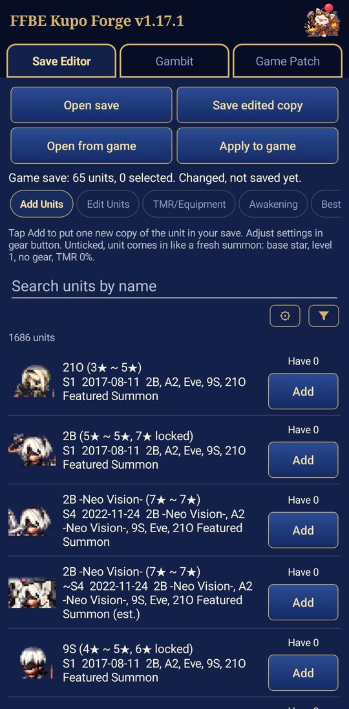
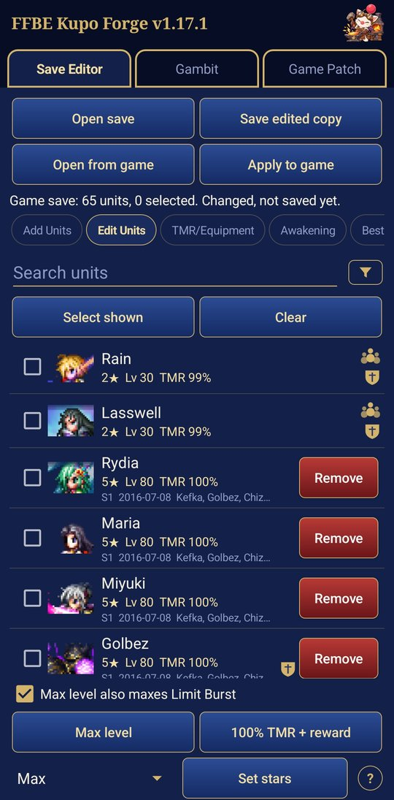
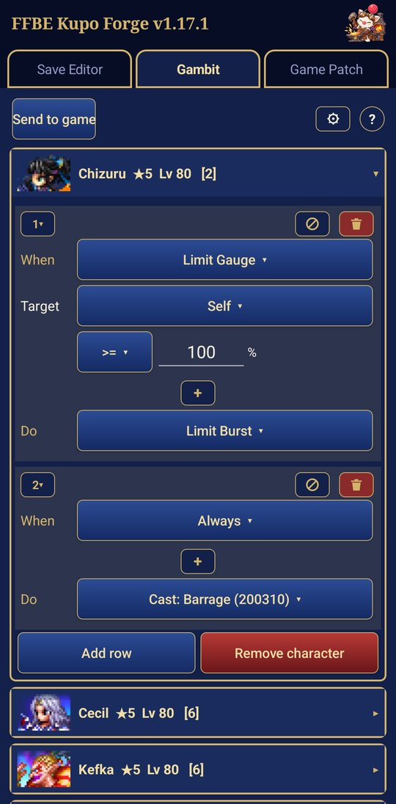
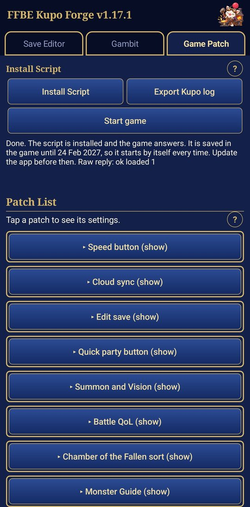
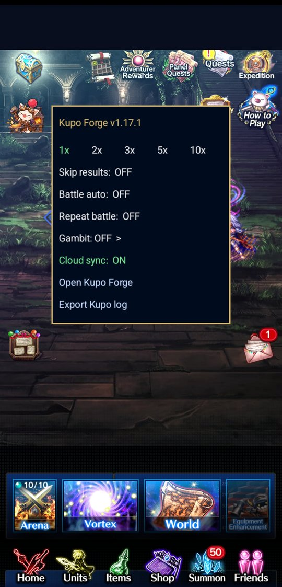

# FFBE Kupo Forge

A save editor plus in-game mods for **FFBE Forever** (Android, `com.exvius.offline.forever`).

> **AI-Assisted. ALWAYS BACK-UP YOUR SAVE.**
> This is an unofficial community tool. The FFBE Forever developer is not responsible for fixing bugs caused by it.

## Download
Get the latest APK from the **[Releases page](https://github.com/Kuruchiii/FFBE-Forever---Kupo-Forge/releases)**.

## Install
1. In the game title screen, turn on third-party tools: **System > Third Party > Allow third-party tools**. Close the game completely and open it again.
2. Install the Kupo Forge APK (allow "install unknown apps" if Android asks).
3. Open Kupo Forge, go to the **Game Patch** tab and tap **Install Script**. If the game is closed, the app opens it for you.
4. Restart the game. You will see the moogle button in game.
5. In the **Patch List**, turn on the mods you want. Every mod starts **Off**. After you change a switch, tap Install Script again and restart the game.

### Updating
- Install the new APK over the old one. Your settings stay.
- Tap **Install Script** again and restart the game.
- The installed script works for about 90 days. Update the app before the date shown under Install Script, then tap Install Script again.

## Found a bug?
1. Turn the switch of that mod off, tap Install Script, restart the game. If it still happens, send the logs.
2. **Game log:** in the game title screen, System > Troubleshooting > **Export log to Downloads**.
3. **Kupo log:** in Kupo Forge, Game Patch tab > **Export Kupo log** (also in the in-game moogle menu).
4. Post both in the Discord channel: https://discord.com/channels/1568125874983665676/1573891559043104801

## Features
Every mod is a switch in the Patch List and starts Off.
- **Save Editor:** add units, edit units (level, stars, TMR, upgrades, remove), items and equipment, awakening materials, Bestiary, missions, summons.
- **Open from game / Apply to game:** edit your save while the game runs. The game restarts to load it.
- **Gambit:** rules per unit ("When ... do ...") for battles, with presets. Similar to FFXII system.
- **Chamber of the Fallen sort:** open trials at the top of the list.NO MORE SCROLLING THROUGH LONG LIST
- **Speed button:** 1x to 10x game speed.
- **Skip results, auto battle (using game's auto mode), repeat battle.**
- **Quick party button**
- **Monster Guide unlock.**
- **Auto cloud sync:** keeps your save in a cloud folder (one file per save slot).
- **Moogle menu in game:** shows the Kupo Forge menu, with a switch in the app to hide it.

## Screenshots
| Add Units | Edit Units |
|---|---|
|  |  |

| Gambit | Game Patch |
|---|---|
|  |  |

| Moogle menu in game |
|---|
|  |

## FAQ
**Nothing works / a button is missing.**
Tap **Install Script** again and restart the game. Check that Allow third-party tools is on in the game's Settings.

**How do I set up cloud sync?**
- Game Patch tab > **Cloud sync** > **Choose sync folder**. Select the 3 lines at the upper left, then pick an online folder on the left bar (Google Drive, Dropbox, Syncthing, FolderSync). Tap **Use this folder**.
- Turn on **Auto cloud sync** in the Patch List, tap Install Script, restart the game.
- Each game save slot has its own cloud file. The first slot is `ffbe_save_latest.json`. Other slots are `ffbe_save_<slot>.json`.
- When the phone and cloud save differ, a box asks which one to keep. Nothing is merged. The other one is backed up.
- Push and Pull in the app let you choose which slot to use, and can create a missing slot on the phone.
- On an emulator such as BlueStacks the Drive folder may not show in the picker. Use a folder that your sync app already uses.

**What is Gambit and how do I use it?**
Gambit casts for your units in battle by rules. Open the **Gambit** tab, add a character, and add rows. Each row is "When [condition], do [action]". The top row that fits wins. Example: row 1 "When Limit Gauge >= 100%, do Limit Burst"; row 2 "When Always, do Cast: Barrage". Tap **Send to game**, then turn **Gambit** On in the in-game moogle menu by selecting the Gambit Pre-set you want to use. Gambit starts Off every launch.

**Where are my backups? How do I restore?**
- The game keeps its own backups: Settings > Saves in the game (Export save, Show backups, Restore).
- Kupo Forge backs up your phone save before it loads a cloud save, and the old cloud file before it is replaced (in the `backups` folder of the sync folder).
- Apply to game also keeps your old game save.

**Is it safe?**
The game is offline, so nothing is sent to a server. Use it at your own risk and ALWAAAAAAYS back up your save first.

**Which devices and game versions?**
Tested on phones and a tablet, on game 0.1.17-beta. Game 0.1.19-beta uses the same game code, but is not fully tested yet.

## Known issues
- Gambit does not skip summon animations.
- Dual cast in battle may not always work.
- While Gambit is On, the moogle panel is not redrawn on battle screens. Tap the moogle again to open it.
- The "save time before the game's autosave" in the cloud sync question can be wrong.
- Story characters (for example Rain, Lasswell) have no Remove button.
- Turning the moogle on in the middle of a battle may only show it after the next screen change.

## Credits and license
- FFBE Forever is made by **Frostzone**. Kupo Forge is an unofficial add-on by the community.
- Kupo Forge is built with AI assistance.
- No license has been chosen yet. All rights reserved by the author until one is added.
- This repo has no keys or secrets, and none should be added.
